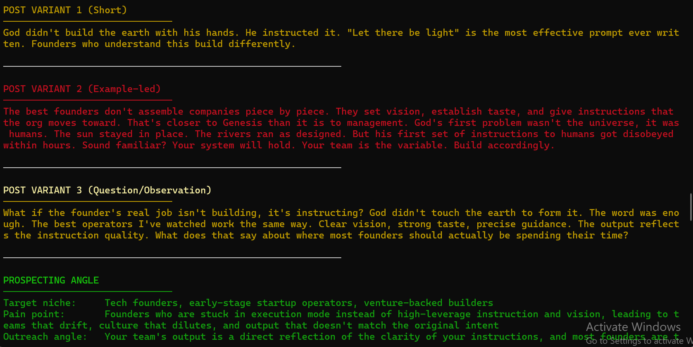

# content-CLI

A local CLI tool that turns a raw idea into X post variants and a client prospecting angle — simultaneously, in one command.

Built for solo consultants who want to generate content and surface business leads from the same thinking, without switching tools.

---

## What it does

Drop a raw idea into the terminal. Get back:

- **3 X post variants** — short/punchy, example-led, and observation-framed
- **A prospecting angle** — target niche, pain point, outreach framing, and example prospect type
- **An auto-logged entry** in `/log/content-log.md` with a timestamp

Every run compounds. The log becomes a searchable content and lead database over time.

---

## Stack

- Node.js
- Anthropic Claude API (`claude-sonnet-4-6`)
- Local markdown file for storage — no database, no cloud

---

## Setup

```bash
git clone https://github.com/EarlTrapo/content-CLI.git
cd content-CLI
npm install
```

Create a `.env` file in the root:

```
ANTHROPIC_API_KEY=your_key_here
```

---

## Usage

```bash
node engine.js "your raw idea here"
```
## Demo


**Flags:**

```bash
node engine.js --list              # print last 5 log entries
node engine.js --search automation # search log by keyword
```

---

## Output format

Each run prints to terminal and appends to `/log/content-log.md`:

```
[YYYY-MM-DD HH:MM] | {first 8 words of idea}

Post variant 1 (short)
Post variant 2 (example-led)
Post variant 3 (question/observation)

Prospecting angle:
- Target niche
- Pain point
- Outreach angle
- Example prospect
```

---

## Why I built this

Content creation and prospecting are the same cognitive act — you're identifying a problem and framing it clearly. This tool runs both in parallel so neither gets skipped.
